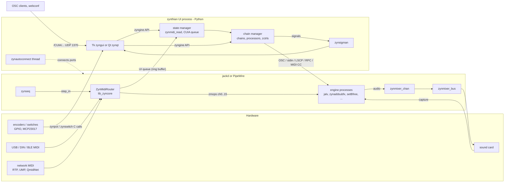

# zynthian architecture

Status: 2026-11-11, branch `main` (tomita base plus the Nura/Qt port). Written from the code;
file:line references are to `zynthian-ui` unless another repository is named (`zyncoder` =
lib_zyncore, `zynthian-sys`, `zynthian-webconf`, all under `~/bastel/github`). Line numbers
drift: search for the named function if one is off. *(unverified)* marks statements not checked
in the code; **Open** marks open questions.

Related documents (not repeated here): [qt-hardware-input.md](qt-hardware-input.md) (encoders
and switches), [osc-interface.md](osc-interface.md) (OSC and the CUIA list),
[qt-port-plan.md](qt-port-plan.md), [upstream-candidates.md](upstream-candidates.md) (known bugs
and races), [multi-zynthian-and-link.md](multi-zynthian-and-link.md) (several zynthians, Ableton
Link).

Contents: 1 Overview · 2 Event processing (hardware, MIDI, UI events, audio, threads) ·
3 UI ↔ engines (zyngine API, controllers, snapshots/ZS3, signals, what the Qt UI reuses) ·
4 Known issues found while writing this.

---

## 1. Overview

### 1.1 Processes

| Process | Started by | Role |
|---|---|---|
| **jackd** (ZynthianOS) / **PipeWire + pipewire-jack** (Nura) | `zynthian-sys/etc/systemd/jack2.service` (`jackd #JACKD_OPTIONS#`, filled in by `zynthian-sys/scripts/update_zynthian_sys.sh:509-511`, default `-P 70 -s -S -d alsa -d hw:0 -r 48000 -p 256 -n 2 -X raw`, :104-106); Nura: the session, nura-builds' `aports/zynthian/postmarketos-ui-zynthian/zynthian-session.sh:51-71` waits for WirePlumber's sink and forces quantum 256 | The audio/MIDI graph. The UI never starts the server (`JackNoStartServer`, e.g. `zynlibs/zynmixer/mixer.c:611`) |
| **zynthian UI** (one Python process) | ZynthianOS: `zynthian-sys/etc/systemd/zynthian.service` → `startx ./zynthian.sh` → `zynthian_main.py` (Tk); Nura/Qt: `zynthian_qt_main.py` (`ZYNTHIAN_UI=qt`) | UI + the whole **zyngine** backend: state manager, chain manager, engines' Python sides, autoconnect, and the in-process native libraries (below) |
| **Engine processes** | the engine classes, `pexpect.spawn`/`Popen` (§3.2) | jalv (one per LV2 processor), zynaddsubfx, setBfree, fluidsynth, linuxsampler, sfizz_jack (one per processor), aeolus, pianoteq, pd (one per processor), sooperlooper, vlc (internet radio); mod-ui/mod-host as systemd services |
| **ctrldev midiproc** (optional) | `zyngine/ctrldev/zynthian_ctrldev_base.py:167-181` (`multiprocessing.Process`) | A driver's realtime MIDI processor between a device and its router input |
| **Network MIDI and helpers** | systemd units started by the state manager (`zyngine/zynthian_state_manager.py:2639-2882`) | qmidinet, jackrtpmidid, jacknetumpd, touchosc2midi, bluetooth MIDI, aubionotes; VNC/noVNC (:2532-2628) |
| **webconf** (tornado) | its own service | Configuration web UI; talks to the running UI only through OSC CUIAs on localhost:1370 (`zynthian-webconf/lib/zynthian_config_handler.py:28-205`) and the files it writes (env vars, snapshots, presets) |

### 1.2 Native libraries inside the UI process (ctypes)

| Library | JACK client(s) | Python wrapper | Role |
|---|---|---|---|
| **lib_zyncore** (`zyncoder`) | `ZynMidiRouter`, `ZynMaster` | `zyncoder/zyncore.py:55` `lib_zyncore_init()`, called by `zyngui/zynthian_gui_config.py:772` `init_zyncore()` | MIDI router (zmips → filters → zmops), the UI MIDI queue, encoders/switches (zynpots, zynswitches), Zynaptik CV/gate, Zyntof, MIDI-to-CV, LEDs |
| **zynmixer** (two builds of `mixer.c`) | `zynmixer_chan`, `zynmixer_bus` | `zynlibs/zynmixer/zynmixer.py:55-62`, two instances (`zyngine/zynthian_state_manager.py:161-162`) | Channel strips, effect sends, mixbuses and main bus, solo/PFL, meters |
| **zynseq** | `zynseq` | `zynlibs/zynseq/zynseq.py` | Sequencer/launcher, tempo, MIDI clock in/out, metronome, JACK timebase master |
| **zynsmf** | `zynsmf` | `zynlibs/zynsmf/zynsmf.py` | MIDI file player/recorder |
| **zynaudioplayer** | one per player | `zynlibs/zynaudioplayer/zynaudioplayer.py` | Audio file player |
| **zynclippy** | `clippy` *(name unverified)* | `zyngine/zynthian_engine_clippy.py:93` | Clip launcher engine |
| **python-jack** client `Zynthian_autoconnect` | | `zynautoconnect/zynthian_autoconnect.py:1829-1869` | Makes and removes all graph connections |

### 1.2a Logs

zynthian logs with Python's `logging` to stderr (`zyngui/zynthian_gui_config.py:71-75`; level
`ZYNTHIAN_LOG_LEVEL`, default WARNING there, INFO when started by `desktop/zynthian_desktop.sh`,
DEBUG with `ZYNTHIAN_DEBUG=1`). Where it ends up:

- Nura kiosk session (tinydm): `~/.local/state/tinydm.log` of the session user (tinydm-run-session
  redirects the session's stdout/stderr there); the previous session's log is `tinydm.log.old`,
  so a session restart (`systemctl restart tinydm`) keeps one generation. RESTART_UI restarts
  zynthian inside the session: same file. Not in the journal.
- The journal has the systemd side only: the session's start/stop, crashes of child processes
  (systemd-coredump: `coredumpctl list`; on the Pi 4 kit core dumps are off, nura-builds
  device-zynthian-rpi4 `50-zynthian-coredump.conf`, which logs "terminated abnormally without
  generating a coredump"). On the kits the journal is volatile (`50-zynthian-journal.conf`):
  `journalctl -b` shows this boot only.
- ZynthianOS: the zynthian service's journal (`journalctl -u zynthian`).

Engine output: jalv's stdout and stderr go to its engine's poll thread, logged at DEBUG
(`LOG <jackname> > ...`); at start, jalv's warnings and errors (`warning:`/`error:` lines before
its prompt) are logged as WARNING, the `-B` fallback as `jalv <jackname>: plugin <URI> not in its
-B bundles => it loaded all of LV2_PATH` (`zynthian_engine_jalv.start`). Other engines' output
is read through pexpect and not logged.

### 1.3 Diagram



Data paths: MIDI devices → router → chains' engines; audio engines → zynmixer strips → main bus
→ sound card. Control paths: UI → zyngine → engine control channels (OSC, stdin, LSCP, HTTP,
MIDI CC through the router); MIDI CC → state manager → `zynthian_controller` → engine; and
back: engine feedback / MIDI → `zctrl.value` + `is_dirty` → UI polling; zynsigman signals →
UI.

---

## 2. Event processing

### 2.1 Hardware: encoders and switches

Covered in [qt-hardware-input.md](qt-hardware-input.md). Summary: lib_zyncore reads switches
and encoders from GPIO/MCP23017 interrupts (wiringPi ISR threads) and poll threads
(`zyncoder/zynmcp23008.c`, `zynrv112.c`, `zyntof.c`, `zynaptik.c`); the UI polls them
(Tk: "Control" thread `control_thread_task`, `zyngui/zynthian_gui.py:2786-2808`, calls
`zynswitch_read()` (:2657) and the encoders through `zynpot_cb` into the "zynpot" thread
(:2756-2777); Qt: `zynqt/hw_input.py`). Switch presses become `zynswitch i,P/R` CUIAs and are
timed into short/bold/long in the CUIA thread; switches configured as MIDI send directly into
the router (`zyncoder/zyncoder.c:291-377`, the `ZMIP_FAKE_INT` input).

### 2.2 MIDI

#### Router structure (lib_zyncore `zyncoder/zynmidirouter.{h,c}`)

Bring-up: `init_zynmidirouter()` (`zyncoder/zynmidirouter.c:64`) → `init_zynmidi_buffer`
(:2172), `init_midi_router` (:99), `init_jack_midi("ZynMidiRouter")` (:1192).
(`zyncoder/zynmidirouter.txt` is outdated; don't rely on it.)

**zmips** (inputs, `zynmidirouter.h:144-191`, 29 in all):

| Index | Name | JACK port | Flags |
|---|---|---|---|
| 0–23 | `ZMIP_DEV0..23` | `ZynMidiRouter:dev{n}_in` | UI, FILTER, ACTIVE_CHAIN, SYSTEM, SYSTEM_RT |
| 24 | `ZMIP_SEQ` | `seq_in` (zynsmf player) | UI |
| 25 | `ZMIP_STEP` | `step_in` (zynseq) | UI, FILTER |
| 26 | `ZMIP_FAKE_INT` | ring buffer: zyncoder switches, Zynaptik CV, Zyntof | UI, FILTER, DIRECTIN |
| 27 | `ZMIP_CTRL` | `ctrl_in` (engine feedback, setBfree) | UI; routed to no zmop (:1249) |
| 28 | `ZMIP_FAKE_UI` | ring buffer: Python `ui_send_*` (:1960-1998) | DIRECTIN only |

**zmops** (outputs, `zynmidirouter.h:237-298`, 43 in all): `ZMOP_CH0..15` = `ch{n}_out`, one
per MIDI chain; 16 `mod_out` (MOD-UI); 17 `step_out` (to zynseq); 18 `ctrl_out` (controller
feedback, unconnected, see below); 19–42 `ZMOP_DEV0..23` = `dev{n}_out` to hardware.

**`jack_process`** (`zynmidirouter.c:1357`), per period:
1. Prime one event per zmip (JACK buffer or ring buffer, :1279, :1343); merge all zmips in time
   order (:1389).
2. Drop Active Sense and **every MIDI clock 0xF8** (:1410-1415); other realtime messages pass only
   with SYSTEM_RT, system common/SysEx only with SYSTEM (:1417-1428).
3. Global filter/remap if FILTER (`midi_filter.event_map`, :1454-1488) — set from
   `zyngine/zynthian_midi_filter.py` scripts (IGNORE / MAP / CLEAN rules), loaded by
   `zynthian_state_manager.init_midi_filter()` (`zyngine/zynthian_state_manager.py:2314`).
4. Master channel: the event goes to the UI queue only (:1491).
5. UI capture: if the zmip has the UI flag, the event goes to the **UI queue**
   (`zynmidi_buffer`, a 16 KB `jack_ringbuffer`, one `uint32` per event: `izmip<<24 | status<<16
   | d1<<8 | d2`, SysEx in 4-byte chunks; :1510-1555). Events on channels in the zmip's
   `ui_midi_chans` mask stop here (:1553): that is how ctrldev drivers take a device away from the
   chains.
6. Per zmop (:1578-1686): skip if unconnected or not routed from this zmip
   (`zmop_set_route_from`, :960). Then:
   - **ACTI mode** (zmip flag ACTIVE_CHAIN, zmop with one channel): the event goes only to the
     **active chain**'s zmop (or every chain on the active chain's channel when
     `active_midi_chan` is set), the channel rewritten to the zmop's (:1598-1624); note-offs go
     to the chain that got the note-on (:1564-1575); held pedals follow.
   - **MULTI mode**: the zmop takes only its enabled channels (:1625).
   - Drop CC unless whitelisted in `cc_route` (DROPCC; synth chains drop CC and PC,
     `zyngine/zynthian_chain.py:148-158`, whitelist = pedals 64/66/67/69,
     `zyngine/zynthian_chain_manager.py:325-343`), drop PC (DROPPC, except from FAKE_UI), notes,
     system (:1641-1668).
   - `zmop_push_event` (:1716): note range, transpose (octave + semitone + global), channel
     translation, fine tuning by pitch bend (:1764).
7. Flush the DIRECTOUT ring buffers (`zmop_send_*`, `dev_send_*`, `ctrlfb_*`) into the JACK
   buffers (:1694-1709).

Consequence: **notes and pedals reach synth engines directly through the router; CCs to synth
chains don't — they go through Python** (below), which maps them to controllers and sends them
on by the engine's own channel.

#### Devices → zmips (autoconnect)

`_midi_autoconnect()` (`zynautoconnect/zynthian_autoconnect.py:770-1121`) gives each hardware
MIDI port a stable slot in `devices_in[]`/`devices_out[]` and connects it to `dev{n}_in` /
`dev{n}_out` (:789-876), through the ctrldev midiproc if there is one (:815-826). Network MIDI,
TouchOSC, ZynMaster and aubio ports count as hardware (:717-729). Chain zmops `ch{n}_out` connect
to the chain's first MIDI processor (:944-960); zynseq `output → step_in`, `step_out →
zynseq:input` (:962-982); clock (:999-1011); `ctrl_in` from engines with `ctrl_fb` (:1032-1044).
Device names/uids: `build_midi_port_name` (:1553-1653), PipeWire `Midi-Bridge:` ports through
`zynautoconnect/zynthian_pipewire_ports.py`.

#### The UI queue → Python (`zynmidi_read`)

Thread **"Status Manager Fast"** (`zyngine/zynthian_state_manager.py:253-256`,
`fast_thread_task` :705-713, every 10 ms) calls `zynmidi_read()` (:742-937): it reads all
pending words (`get_zynmidi_num_pending`, `read_zynmidi_buffer`), reassembles SysEx (:762-779,
a SysEx split across reads is dropped, :774-776), and dispatches each event:

1. **ctrldev driver** of that zmip first (`ctrldev_manager.midi_event`, :778-781;
   `zyngine/zynthian_ctrldev_manager.py:442`); if it consumes the event, done.
2. **System**: SysEx from devices → signal `SS_MIDI_SYSEX`; clock sets `status_midi_clock`
   (:796-797; in practice never, the router drops 0xF8).
3. **Master channel** (`zynthian_gui_config.master_midi_channel`): webconf-configured snapshot
   program/bank up/down, PC → `load_snapshot_by_prog`, bank CC, CC 120/123, **CC learn on the
   master channel** (:844-845), and **note → CUIA** mappings (`master_midi_note_cuia`, with
   zynswitch press/release emulation, :846-866) put into the CUIA queue.
4. **CC** (< 120): `chain_manager.midi_control_change(izmip, chan, cc, val)` unless learning,
   then always signal `SS_MIDI_CC` (queued) (:869-877). CC 120/123: all sounds/notes off on the
   channel.
5. **PC**: in PC-learn mode save a ZS3 `"chan/pgm"`; else if `midi_prog_change_zs3` load the ZS3
   `"chan/pgm"` (falls back to `"*/pgm"`); else `chain_manager.set_midi_prog_preset(chan, pgm)`
   with the channel replaced by the active chain's in ACTI mode (:881-911). Signal `SS_MIDI_PC`.
6. **Note on/off** from devices: signals only (`SS_MIDI_NOTE_ON/OFF`), for learn screens,
   the launcher etc. (:913-925).

#### CC → controllers (`midi_control_change`, `zyngine/zynthian_chain_manager.py:1840-1917`)

In order: bank select CC0/CC32 when `midi_bank_change` (:1850-1864); **engine feedback** on
`ZMIP_CTRL` (setBfree sends its drawbar state back as CCs): sets the zctrl with `send=False`
unless it is ignoring feedback after a preset load (:1868-1884); **absolute bindings** keyed
`(zmip<<16)|(chan<<8)|cc` (:1887-1893); then **chain bindings of the active chain only**, keyed
`(chain_id<<16)|(chan<<8)|cc` with chan 0xff for "any channel" (:1899-1915). Each matched zctrl
gets `zctrl.midi_control_change(val)` (`zyngine/zynthian_controller.py:651-729`): CC mode
auto-detection (absolute or one of four relative encodings), range mapping
(`midi_cc_val1..val2`, log, toggle, momentary), optional 20 ms debounce, then `set_value()`
→ the engine (§3.3).

#### MIDI learn

- Router side: only a flag, `set_midi_learning_mode` (`zynmidirouter.c:232`), which stops
  reading `ZMIP_CTRL` so engine feedback isn't learned (:1371).
- Python: `enable_learn_cc(zctrl)` / `enable_learn_pc(name)` / `disable_*`
  (`zyngine/zynthian_state_manager.py:2254-2296`). While a zctrl is being learned,
  `zynmidi_read` skips the CC dispatch but still signals `SS_MIDI_CC`; the learn screen's
  callback (Tk `zyngui/zynthian_gui_control.py:115`, `midi_learn_bind` :756; Qt via
  `zynqt/bridge.py` `midiCc`) calls `chain_manager.add_midi_learn(chan, cc, zctrl, zmip)`
  (`zyngine/zynthian_chain_manager.py:1670-1724`).
- **Chain vs global**: `zmip=None` → chain binding (`chain_midi_cc_binding`, active only while
  its chain is active); a zmip → absolute/global binding (`absolute_midi_cc_binding`, always
  active, tied to that device). Each zctrl on a MIDI chain also gets a **ZynStep** binding
  (`ZMIP_STEP`, the chain's channel) so zynseq's CC automation reaches it (:1715-1722).
- Persistence: chain bindings in each ZS3's chain state (`midi_learn`, :1740-1746 of the state
  manager), absolute ones in the ZS3's MIDI capture state per device uid (:2140-2147),
  restored by `load_zs3` (:1520-1550) and `set_midi_capture_state` (:2220-2248).

#### Program changes, banks and ZS3

See above (5.). ZS3 = "sub-snapshot": a stored set of chain and processor states inside the
current snapshot (§3.5). PC on the master channel switches **snapshots**, PC on a chain channel
switches **ZS3s** (if enabled) or **presets** of the synths on that channel
(`set_midi_prog_preset`, `zyngine/zynthian_chain_manager.py:1946-1965`: every "MIDI Synth"
processor on that channel; FluidSynth on channel 10 skipped).

#### MIDI clock and transport

Not through the router: autoconnect connects the selected clock source device directly to
`zynseq:clock_in` and `zynseq:clock` to the selected outputs (autoconnect :999-1011); zynseq
locks to it with a PLL and is the JACK timebase master. Details in
[multi-zynthian-and-link.md](multi-zynthian-and-link.md) §2.2.

#### MIDI feedback to controllers

- **ctrldev drivers** send LEDs, motor faders, displays through `dev_send_*` into the device's
  zmop (`ZMOP_DEVn`), from signals they register (`SS_ZYNMIXER_SET_VALUE` queued,
  `zyngine/ctrldev/zynthian_ctrldev_base.py:528`; active chain, view position, sequencer state).
- **CC feedback broker** (`zyngine/zynthian_cc_feedback.py`, `chain_manager.cc_feedback`, upstream
  d6d08865 / 6f18babb): drivers that mirror controllers (APC40 mk2 encoders, Behringer Motor
  faders, FCB1010 riban) register their zmip with a callback and their bindings; the broker
  follows MIDI-learn bindings and the active chain and sets `zctrl.feedback` on each bound zctrl.
  `zctrl.send_feedback()` (`zyngine/zynthian_controller.py`) passes a value change to it, from
  whichever thread sets the value. (The per-zctrl callback list `send_value_cb` of 91d51107 is
  gone since 6f18babb.)
- **Generic CC feedback** (`ZMOP_CTRL`, `ctrlfb_send_*`): the zmop's connection is commented out
  (`zynautoconnect/zynthian_autoconnect.py:1054-1058`), so it is drained and dropped
  (`zynmidirouter.c:1703`): no generic "send learned CC values back to the device".
- **MIDI-to-CV**: the `ZynMaster` client (`zyncoder/zynmaster.c:44-74`) turns MIDI into Zynaptik
  CV/gate; it appears as a hardware MIDI output in autoconnect.

#### ctrldev drivers (`zyngine/ctrldev/`)

`zynthian_ctrldev_manager` (`zyngine/zynthian_ctrldev_manager.py`) loads a driver per zmip by
device id (`load_driver`, :195-267; autoload flag per class), optionally unroutes the device from
the chains (`zmip_set_ui_midi_chans`, :245-251), and gives it every MIDI event of its device
first. Base classes in `zynthian_ctrldev_base.py`: `zynthian_ctrldev_base` (MIDI in/out, sleep,
state, active chain), `_zynpad` (launcher pads, :383), `_zynmixer` (mixer strips, :515),
plus `_base_extended`, `_base_moder`, `_base_ui`. HID drivers have no zmip
(`update_hid_drivers`, :301). Driver state is saved in the ZS3's MIDI capture state.
Note: several drivers call Tk screens directly (`zynthian_gui_config.zyngui.screens[...]`,
e.g. `zynthian_ctrldev_base_ui.py:45-81`, `zynthian_ctrldev_akai_apc_40_mk2.py:355-705`), so
they depend on the UI implementation.

The DrivenByMoss drivers live here too (moved from drivenbymoss-rust's `backends/zynthian`,
2026-11-25): `zynthian_ctrldev_base_dbm.py`, `zynthian_ctrldev_dbm_*.py` and the adapter package
`dbm_zynthian/` (README there), tests in `tests/dbm/` (own runner: `./run_tests.sh dbm`), notes in
`docs/dbm/`. They run a controller in the DrivenByMoss core (library, `drivenbymoss` binding and
`dbm_host` from the drivenbymoss package, or `DBM_PYTHON_DIR` / `DBM_LIBRARY`); if the binding's
protocol doesn't match the library's, they log an error and are not loaded.

### 2.3 UI events: CUIAs

A **CUIA** (Callable UI Action) is a name plus parameters, e.g. `ZS3_LOAD zs3-2`,
`ZYNSWITCH 3,S`, `ZYNPOT 1,-1`. The list is in [osc-interface.md](osc-interface.md).

Sources, all ending in **`state_manager.cuia_queue`** (`SimpleQueue`,
`zyngine/zynthian_state_manager.py:154`; `send_cuia()` :564):

| Source | Where |
|---|---|
| Switches (incl. wiring-configured custom switches) | Tk `zynswitch_read` → queue; Qt `zynqt/hw_input.py` ([qt-hardware-input.md](qt-hardware-input.md)) |
| Keyboard bindings | Tk `zyngui/zynthian_gui_keybinding.py`; Qt `zynqt/keyboard.py` |
| OSC `/CUIA/<name>` on UDP 1370 | Tk `osc_cb_all` (`zyngui/zynthian_gui.py:351-418`, polled by the Control thread); Qt `_osc_cb` (`zynqt/ui.py:1297-1310`, liblo ServerThread) |
| Master-channel MIDI notes | `zynmidi_read` (:846-866) |
| ctrldev drivers, touch keypad, webconf (via OSC), engine code | `send_cuia` / `cuia_queue.put_nowait` |

**Dispatch.** One consumer thread per UI:
- **Tk**: thread "CUIA" (`task_cuia_thread`, `zyngui/zynthian_gui.py:2973-…`) times
  zynswitch press/release into short/bold/long (with auto-long and auto-repeat), then calls
  `callable_ui_action(cuia, params)` (:1173-1191) **in the CUIA thread**: the current screen's
  `callable_ui_action`, then its `cuia_<name>`, then the UI's own `cuia_<name>`. The calls touch
  Tk widgets from that thread; tkinter (threaded Tcl) marshals them into the main loop thread,
  so it works but serialises on Tk.
- **Qt**: thread "cuia" (`_cuia_task`, `zynqt/ui.py:948-…`) does the same timing, then emits a
  queued Qt signal (`_cuiaRequested`) so `_run_cuia` (:1265-1287) runs **in the GUI thread**:
  current screen's `cuia_<name>` (if it returns True, done), else `ZynUI.cuia_<name>`.
- Both drop CUIAs while the state manager is busy *(per osc-interface.md, for OSC)* and treat
  every CUIA but `POWER_SAVE` as user activity (`set_event_flag`).

Screens: Tk keeps a dict of `zynthian_gui_*` screen objects (`zyngui/zynthian_gui.py`,
`show_screen`), Qt a stack of QML screens with Python controllers (`zynqt/screens/*.py`). Both
are driven by the same CUIAs and signals.

### 2.4 Audio

#### Chains

A chain (`zyngine/zynthian_chain.py:41-82`) has three slot lists: `midi_slots`, `synth_slots`,
`audio_slots`; each slot is a list of processors that run in parallel, slots run in series
(new processors currently always get a new slot, :663-670). Fields: `chain_id` (0 = main),
`midi_chan` (None = audio-only, 0xffff = all channels), `zmop_index`, `midi_in/out`,
`audio_in/out`, `midi_thru`/`audio_thru`, `zynmixer_proc`. Types (:134-142, 499-532): MIDI,
synth, audio (has a mixer strip), generator/special, mixbus (MR without synth), audio input.
The mixer processor (`MI` strip or `MR` bus) sits in `audio_slots`; its position splits pre-
and post-fader effects.

The chain builds its own routing table: `rebuild_audio_graph` (:313-363; capture inputs →
first slot → … → `zynmixer_*:input_NN`; `output_NN` → `audio_out`, by default `[0]` = the main
chain) and `rebuild_midi_graph` (:386-425; zmop → MIDI slots → synth → `midi_out`), then
requests autoconnect.

The chain manager (`zyngine/zynthian_chain_manager.py`) owns `chains`, `processors` (by id),
`zyngines` (by engine code), `active_chain`: `add_chain` (:248-357: allocates a zmop, routes it
from all devices + step/seq/int, sets the active chain), `remove_chain` (:393-480), `add_processor`
(:1082-1160: creates a `zynthian_processor`, one synth per chain, `start_engine`),
`set_active_chain_by_id` (:979-1013: `lib_zyncore.set_active_chain(zmop)`, zynseq channel,
`SS_SET_ACTIVE_CHAIN`).

#### zynmixer

Two builds of `zynlibs/zynmixer/mixer.c` (`CMakeLists.txt:9-15`): `zynmixer_chan` (channel
strips with effect sends) and `zynmixer_bus` (`-DMIXBUS`: strip 0 = main bus, 1 = aux bus with
metronome and audio player, then mixbuses), `MAX_CHANNELS` 99 (:38-40). Per strip ports
`input_NNa/b`, `output_NNa/b` (:1114-1141); trunk ports `solo_a/b`, `pfl_*` (:627-636); sends
`send_NNa/b` (:1211-1248).

`onJackProcess` (:176-521), per sample: gain → phase invert (B) → M/S decode → mono →
pre-fader tap (PFL, pre sends) → level × balance with a linear ramp to the requested value over
the period (click-free) → mute ramp → A/B crossfade groups → outputs, solo bus, post-fader
sends. The main bus takes its input plus internally "normalised" mixbuses (autoconnect
replaces JACK connections from mixbuses to the main bus by `normalise`, autoconnect :1255-1265),
or the solo bus when something is soloed (:338-345).

**Metering**: per sample peak (`dpm`) and hold, decay ×0.9 every damping period (≈1/15 s),
hold reset every 20 damping periods (:437-491); `updateDpmStates()` copies all strips at once
(:1064-1078) into a ctypes array (`zynmixer.py:137, 858-868`). The UIs poll it: Tk
`refresh_status` (`zyngui/zynthian_gui_mixer.py:1407-1421`), Qt `MixerMeters` at
`ZYNTHIAN_QT_METER_HZ` (default 30, `zynqt/models/mixer.py:235-260`).

**Values**: parameters are plain fields written without lock (`setLevel` writes `reqlevel`,
:752-756); the process callback ramps. Every Python `set_*` sends
`zynsigman.send(S_MIXER, SS_ZYNMIXER_SET_VALUE, chan, symbol, value, mixbus)` synchronously
(e.g. `zynmixer.py:252-254`), which updates the Tk mixer, the Qt `MixerModel` (through
`zynqt/bridge.py`) and ctrldev drivers. The strips appear to the rest of zyngine as processors
of the **audio mixer engine** (`zyngine/zynthian_engine_audio_mixer.py`, codes MI/MR): zctrls
gain, level, balance, mute, solo, pfl, mono, ms, phase, record, send levels/modes
(`get_controllers_dict` :60-222; sends added by `chain_manager.refresh_mixbus_sends`,
:1302-1376), so MIDI learn, ZS3 and snapshots handle the mixer like any engine.

Removal: `removeStrip`/`removeSend` take the mixer lock and wait for the process callback to
drop the strip (:1180-1270); see upstream-candidates.md for the deadlock fixed under
pipewire-jack and the endless wait when the graph doesn't run.

#### Autoconnect

Thread **"Autoconnect"** (`auto_connect_thread`, `zynautoconnect/zynthian_autoconnect.py:
1731-1774`): every 0.1 s checks the request flags set by `request_audio_connect()` /
`request_midi_connect()` (:499-527; `fast=True` connects synchronously in the caller's
thread), every ~2 s polls for hardware MIDI/audio port changes and HID devices (no JACK
registration callback; JACK callbacks: xrun counter and the UMP property, :1846-1847,
1920-1953). `_audio_autoconnect` (:1134-1292) and `_midi_autoconnect` compute the full set of
required connections from the chains' routing tables and apply the difference to the
connections zynthian made itself (`zyn_routed_audio`/`zyn_routed_midi`), so user-made
connections survive. A non-reentrant `Lock` (:1863, `acquire_lock` :1777-1803) serialises the
connects and the chains' graph rebuilds. `pause()`/`resume()` (:1894-1901) stop it during
snapshot loads. Default audio path: system capture → chain → `zynmixer_chan:input_NN` →
`output_NN` → `zynmixer_bus:input_00` (main) → `system:playback_1/2` (or, on PipeWire without
`system:` ports, the physical ports by index, :1296-1345).

### 2.5 Threads and locking

| Thread | Code | Does |
|---|---|---|
| Main (Tk mainloop / Qt GUI) | `zynthian_main.py:179` / `zynthian_qt_main.py` | Drawing; Qt also runs all CUIAs and signal handlers that touch QObjects |
| CUIA (Tk "CUIA", Qt "cuia") | `zyngui/zynthian_gui.py:2973`; `zynqt/ui.py:948` | Reads `cuia_queue`; switch timing; Tk runs the CUIA there |
| Control (Tk) | `zyngui/zynthian_gui.py:2786-2808` | Polls switches, OSC (Tk), power-save check |
| zynpot (Tk) | :2756-2777 | Encoder deltas → current screen |
| Status (Tk) / Qt status timer | :2931-2955; `zynqt/ui.py:160` | Status bar, LEDs |
| Busy (Tk) | :2861-2915 | Shows the loading screen while `state_manager.is_busy()` |
| Status Manager Fast | `zyngine/zynthian_state_manager.py:253, 705` | `zynmidi_read`, zynseq beat/progress (10 ms) |
| Status Manager Slow | :248, 580-699 | CPU load, temperature/undervoltage, SMF player/recorder state, `zynseq.update_state`, xrun/MIDI flags, slow callbacks (update check hourly) (200 ms) |
| SIGNAL_QUEUE | `zyngine/zynthian_signal_manager.py:222-241` | Runs queued zynsigman callbacks |
| Autoconnect | `zynautoconnect/zynthian_autoconnect.py:1866` | Graph connections |
| Engine threads | jalv `proc_poll_{jackname}` (`zyngine/zynthian_engine_jalv.py:295-297`, reads jalv's stdout: controller and monitor values), liblo ServerThreads of engines with OSC (`zyngine/zynthian_engine.py:242`), modui websocket (`zynthian_engine_modui.py:321`), inet radio poll | Engine feedback → zctrls |
| zctrl debounce | `threading.Timer` per controller (`zynthian_controller.py:678`) | Debounced `set_value` |
| JACK RT threads | router, mixers, zynseq, zynsmf, players | Audio/MIDI processing |
| lib_zyncore poll/ISR threads | §2.1 | Switches, encoders, CV |
| OSC (Qt) | liblo ServerThread, `zynqt/ui.py:1291` | `/CUIA/*` → queue |

**Locking**: there is little. The zyngine Python objects (chains, processors, zctrls, ZS3 dict)
have no locks; they are changed from the CUIA thread (Tk), the GUI thread (Qt), the MIDI thread
(`zynmidi_read` → zctrls, ZS3 load by PC, snapshot load by PC on the master channel), engine
feedback threads and the signal queue thread. The GIL makes single operations atomic, not
sequences. What there is: the autoconnect `Lock`; zynseq's spin "mutex" `g_bMutex` between API
and process callback (`zynlibs/zynseq/zynseq.cpp`, `onJackProcess`); zynmixer's mutex only for
removal/routing; the router's ring buffers. The **busy** mechanism (`start_busy`/`end_busy`,
`zyngine/zynthian_state_manager.py:400-450`) is the de-facto coordination: UIs show the loading
screen and drop CUIAs, drivers are told to pause while busy.

Known races and thread issues (details in [upstream-candidates.md](upstream-candidates.md)):
- zynseq has no locking between snapshot loading (`SequenceManager::init` deletes everything)
  and readers on other threads (SIGSEGV seen from a driver's thread).
- zynmixer removal waits forever if the process callback doesn't run; deadlock under
  pipewire-jack (fixed in 0a8e28b2).
- Exit with open JACK clients under pipewire-jack: PipeWire's data thread calls Python
  callbacks during interpreter shutdown.
- Possible double long press (control thread and CUIA auto-long).
- lib_zyncore's ring buffers are single-producer/single-consumer `jack_ringbuffer`s, but
  `zynmidi_buffer` has several writers (the router's JACK thread, zyncoder poll/ISR threads,
  Python `write_zynmidi_*` from any thread) and `ZMIP_FAKE_INT`'s buffer several C threads
  (§4). *(No crash observed; a race in principle.)*

---

## 3. How the UI talks to the engines

### 3.1 The zyngine API

```
zynthian_state_manager                         zyngine/zynthian_state_manager.py:92
 ├─ chain_manager: zynthian_chain_manager     zyngine/zynthian_chain_manager.py:110
 │    ├─ chains{id: zynthian_chain}            zyngine/zynthian_chain.py
 │    │     └─ slots → zynthian_processor      zyngine/zynthian_processor.py
 │    │            ├─ engine: zynthian_engine  (shared per engine code, except JV/SF/PD)
 │    │            └─ controllers_dict{symbol: zynthian_controller}
 │    ├─ processors{id: processor}, zyngines{code: engine}
 │    └─ MIDI learn tables (absolute, chain)
 ├─ zynmixer_chan, zynmixer_bus (ZynMixer)
 ├─ zynseq (zynseq wrapper), tempo_processor, alsa_mixer_processor, main_mixbus_proc
 ├─ ctrldev_manager, audio_player, audio_recorder, smf player/recorder
 ├─ zs3{id: state}, snapshot load/save, MIDI capture state, MIDI learn mode
 ├─ cuia_queue, busy state, status flags (xrun, MIDI, clock, temperature, ...)
 └─ services (VNC, network MIDI, bluetooth, aubio)
zynsigman (global signal manager)               zyngine/zynthian_signal_manager.py:247
zynautoconnect (module)                         zynautoconnect/zynthian_autoconnect.py
```

A UI creates one `zynthian_state_manager()` (Tk in `zynthian_gui`, Qt `zynqt/ui.py:90`),
which creates everything, adds the main chain and mixbus, starts autoconnect and its threads
(`start()`, :202-260). From then on the UI calls methods: `chain_manager.add_chain/
add_processor/remove_*`, `processor.set_bank/set_preset/…`, `zctrl.set_value/nudge`,
`state_manager.load_snapshot/save_snapshot/load_zs3/save_zs3/enable_learn_cc/…`,
`zynseq.*`, `zynmixer_*.set_*`, `zynautoconnect.*` for routing options.

Processor (`zyngine/zynthian_processor.py`): bank and preset lists and selection
(`get_bank_list` :199, `set_bank` :240, `load_preset_list` :329, `set_preset` :355, favourites),
controller screens (`init_ctrl_screens` :619, `get_ctrl_screen` :650), bypass, keymaps,
`get_state`/`set_state` (:858-971).

### 3.2 Engine classes and their control channels

`zynthian_basic_engine` (`zyngine/zynthian_engine.py:62-140`) starts the process with
`pexpect.spawn` (TERM=dumb so readline prompts match), `proc_cmd()` = send a line, wait for the
prompt; `zynthian_engine` adds bank/preset file handling, controller dict generation
(`get_controllers_dict` :652, `generate_ctrl_screens` :687), and an OSC client + reply server
(`osc_init` :237-250).

| Engine (code) | Process | Control channel UI → engine | Engine → UI |
|---|---|---|---|
| LV2 plugins via jalv (`JV/…`) | one `jalv -n <jackname> <uri>` per processor, `Popen` with pipes (`zyngine/zynthian_engine_jalv.py:88-103, 135-155`) | stdin `set <index> <value>` or `symbol=value` (:571-601); MIDI CC for controllers with `midi_cc` | stdout parsed by the poll thread (:211-293): control port values, monitors, presets |
| ZynAddSubFX (`ZY`) | `zynaddsubfx -O jack-multi -I jack -P 6693 -a` (`zynthian_engine_zynaddsubfx.py:140-165`) | OSC to 6693 (:292-301) | OSC replies |
| setBfree (`BF`) | pexpect | MIDI CC/PC through the chain's zmop (`zynthian_engine_setbfree.py:547, 604-610`) | CC feedback on `ZMIP_CTRL` (§2.2) |
| FluidSynth (`FS`) | `fluidsynth -a jack -m jack …` | stdin shell (`load`, `select`, …, :281-426); controllers by MIDI CC | prompt output |
| LinuxSampler (`LS`) | `linuxsampler --lscp-port 6688` | LSCP over TCP (`zynthian_engine_linuxsampler.py:103-166`); controllers by MIDI CC | LSCP replies |
| sfizz (`SF`) | one `sfizz_jack` per processor | stdin `load_instrument` (:157); controllers by MIDI CC | — |
| Aeolus (`AE`) | `aeolus -o 9000 -O localhost:<port>` | OSC for stops; MIDI CC for swell etc. (`zynthian_engine_aeolus.py:650-660`) | OSC |
| Pianoteq (`PT`) | `pianoteq --serve 9001 …` | HTTP JSON-RPC (`zynthian_engine_pianoteq.py:613-623`); MIDI CC | RPC replies |
| Pure Data (`PD`) | one `pd -jack …` per processor | OSC port 3000+10·id; MIDI CC (`zynthian_engine_puredata.py:53-71, 253-265`) | OSC back on +1 |
| SooperLooper (`SL`) | `sooperlooper -p 9951` | OSC `/sl/…` (`zynthian_engine_sooperlooper.py:603-617`) | OSC registrations |
| MOD-UI (`MD`) | `systemctl start mod-ui` | HTTP + websocket `param_set` (`zynthian_engine_modui.py:51-52, 300-321`) | websocket |
| Internet radio (`IR`) | `vlc` | TCP 4212 | poll thread |
| In-process: mixer (`MI`/`MR`), audio player (`AP`), clippy (`CL`), SysEx (`SX`), MIDI control (`MC`), ALSA mixer (`MX`), tempo (`TP`) | ctypes / Python | direct calls | signals, polling |

Stopping: `stop()` ends the process with `end_process()` (`zyngine/zynthian_engine.py`): an
optional grace period after the engine's own quit command (sfizz `quit`, fluidsynth `quit`,
aeolus `/exit`, pianoteq RPC `quit`), then signals (pexpect: HUP, CONT, INT, TERM; Popen: TERM),
5 s (`PROC_STOP_TIMEOUT`), SIGKILL, and if the process is still there after 2 s more (e.g. its
core dump being written) a background thread reaps it. jalv has no quit command: SIGTERM, then
`communicate()` (closes stdin, which jalv's exit waits for on musl, and reaps), SIGKILL after 5 s.
Several unused engines are stopped in parallel (`stop_engines`).

Engine instances are shared per engine code (one ZynAddSubFX for all its processors, parts by
MIDI channel), except jalv, sfizz and Pd (one process per processor,
`zyngine/zynthian_chain_manager.py:1464-1475`) and the single-processor engines BF, MD, PT,
AE, SL, IR (:113).

#### Zynthian widgets of LV2 plugins (zyngui:widget)

Since upstream a1527c99 an LV2 plugin's zynthian widget (spectrum, tuner, …) is an LV2 UI of
class `zyngui:widget` (ontology `lv2/zyngui.lv2/zyngui.ttl`) whose `ui:binary` is the Python
module `zynthian_widget_<name>.py`, declared in an extension bundle (`manifest.ttl`, usually
with the module beside it) anywhere on LV2_PATH. `zynthian_lv2.get_plugin_zyngui_widget()`
finds it through lilv (`zynthian_engine_jalv.get_custom_gui_fpath()`); a widget outside
zynthian-ui wins over a built-in one. New, removed or changed bundles are picked up while
running (6d8ca287): `check_lv2_changes()` compares the modification times of the LV2_PATH
directories (and `$ZYNTHIAN_CONFIG_DIR/lv2.stamp`, to touch after editing files inside a
bundle) when a processor is added or the Tk control screen shows its widget, and reloads the
lilv world.

| Where | What |
|---|---|
| `$ZYNTHIAN_UI_DIR/lv2/` | the built-in widget bundles (meters, tuna, aidax, nam, gxgraphiceq, chord-analyzer; samplv1's points at the shared `zyngui/zynthian_widget_audio_file.py`) |
| `$ZYNTHIAN_PLUGINS_DIR/lv2-widgets/` | user and external widgets. On the desktop and on Nura `ZYNTHIAN_PLUGINS_DIR` is the user's `~/.local/share/zynthian/plugins` (XDG data, writable; the packaged files are in `/usr/share/zynthian`), so this is `~/.local/share/zynthian/plugins/lv2-widgets`; the launcher creates it. ZynthianOS: `/zynthian/zynthian-plugins/lv2-widgets` |
| `$ZYNTHIAN_PLUGINS_DIR/lv2-presets/` | preset bundles, on LV2_PATH as on ZynthianOS |

`desktop/zynthian_desktop_env.sh` puts these on LV2_PATH in zynthian-sys's order (also when the
session set LV2_PATH before). ZynthianOS's `migrate_user_widgets.py` (old
`zyngui/widgets_user/zynthian_widget_<plugin>.py` files into bundles) has no counterpart in the
port: desktop and Nura installs have no such files. The Qt UI doesn't run the Tk widget modules:
it has QML views for the widget names in `zynthian_widget_data.PLUGIN_WIDGETS` (chosen by the
module's file name) and the envelope, filter and audio file views; a plugin whose widget has
another name shows its controllers. It reads the widget when the processor is created (no
`refresh_custom_gui()`).

### 3.3 How values flow

**UI → engine**: `zctrl.set_value(v, send=True)` (`zyngine/zynthian_controller.py:490-501`)
clamps/converts, then `send_value()` (:503-529): the engine's `send_controller_value(zctrl)` if
it implements one; otherwise OSC (`liblo.send(engine.osc_target, osc_path, …)`) if the zctrl
has an OSC path, else MIDI CC (`send_midi_cc`, :532-547: `zmop_send_ccontrol_change` into the
chain's zmop, or `ui_send_ccontrol_change` via `ZMIP_FAKE_UI`). Then `send_feedback()`: the CC feedback
broker (driver feedback, if the zctrl is bound) and, for bypass zctrls, `SS_PROCESSOR_BYPASS`. `is_dirty = True`.

**MIDI → engine**: CC → `midi_control_change` → `zctrl.midi_control_change` → `set_value` →
same path. Notes/pedals bypass Python (router → engine).

**Engine → UI**: feedback threads (jalv stdout, OSC servers, setBfree CC) call
`zctrl.set_value(v, send=False)` or set `zctrl.value` and `is_dirty`. There is **no per-value
signal**: the UIs poll the dirty flags of the controllers they show (Tk `plot_zctrls_task` every
32 ms, `zyngui/zynthian_gui.py:2813-2825`, `zynthian_gui_control.py:650-653`; Qt a 50 ms timer,
`zynqt/screens/control.py:123, 293`). Mixer values are the exception (signal per change,
§2.4), and processor-level changes send signals (`SS_PROCESSOR_CTRL_SCREENS`, bypass).

**Feedback loops**: after a preset load, controllers can ignore engine feedback for 2 s
(`set_ignore_engine_fb`, `zynthian_controller.py:366-370`, used in `processor.set_state`,
`zyngine/zynthian_processor.py:917-925`) so a preset's own values don't overwrite the
snapshot's.

### 3.4 Signals (zynsigman)

`zyngine/zynthian_signal_manager.py`: a registry `[signal][subsignal] → [(callback, queued)]`.
Signals (:41-56): `S_STATE_MAN` (snapshot loaded, ZS3 load/save, MIDI player/recorder, busy),
`S_CHAIN_MAN` (add/remove/move/rename chain, add/remove processor, active chain), `S_CHAIN`,
`S_AUDIO_RECORDER`, `S_AUDIO_PLAYER`, `S_SMF_RECORDER`, `S_ALSA_MIXER`, `S_MIXER`
(`SS_ZYNMIXER_SET_VALUE`), `S_STEPSEQ` (play state, state, progress, phrase, tempo, time
signature, metronome, beat), `S_CUIA`, `S_GUI` (show screen, sidebar, control mode, file
selector, message, launcher mode, view position), `S_MIDI` (CC, PC, note on/off, SysEx),
`S_TRANSPORT`, `S_PROCESSOR` (ctrl screens, bypass), `S_WSLEDS`.

`send()` calls the callbacks **in the sender's thread** unless they registered as queued;
`send_queued()` queues every callback to the SIGNAL_QUEUE thread (`process_signal`, :196-208).
The Qt UI registers plain callbacks that only emit Qt signals (`zynqt/bridge.py`), which Qt
delivers queued to the GUI thread.

### 3.5 Snapshots and ZS3

**Snapshot** (`.zss`, JSON; `get_state()`, `zyngine/zynthian_state_manager.py:987-1016`):
`schema_version`, `last_snapshot_fpath`, `midi_profile_state`, `chains` (per chain: MIDI
channel, zmop, slots with processor ids and engine codes, routing; `chain_manager.get_state`),
`zs3` (all ZS3s, `zs3-0` = the current state, saved first by `get_state`), `last_zs3_id`,
`gui.pinned_chains`, `engine_config` (engines' extended config), `zynseq` (all sequences,
patterns, scenes/phrases, tempo). Schema: `zynthian_state_schema.py`. Old formats converted by
`zyngine/zynthian_legacy_snapshot.py`.

**Load** (`_load_snapshot`, :1130-1298): convert legacy, mute, `zynautoconnect.pause()`,
`chain_manager.set_state()` (creates chains, processors, starts engines; stops unused ones),
resume autoconnect, `zynseq.set_state`, then `load_zs3(zs3-0)` restores values, enables MIDI
autolearn, restores the MIDI profile and pinned chains, requests autoconnect, inits MPE, restores
mute, signals `SS_LOAD_SNAPSHOT`. Merge mode remaps chain and processor ids (:1180-1237).
The whole load runs under the busy state "load snapshot". Program change on the master channel
loads snapshots by number from the current snapshot bank (`load_snapshot_by_prog`, :1318).

**ZS3** (`save_zs3`, :1652-1812; `load_zs3`, :1434-1630): a ZS3 holds **values and routing,
not structure** — no chains or processors are created or removed by a ZS3 load, which is why
it is fast:
- per chain: MIDI channel, note range, transpose, `midi_in/out`, `audio_in/out`, chain MIDI
  learn, `restore` flag;
- per processor: bank, preset (and subdirs), every controller's state (value, CC range,
  momentary, debounce), current screen, `restore` flag;
- active chain, active phrase (zynseq), MIDI capture state (per input device: ACTI/MULTI mode,
  routed chains, ctrldev driver and its state, absolute MIDI learn), globals (clock source,
  clock outputs, zynseq excluded inputs, global transpose, XY controllers, Zynaptik CV config);
- title, note, `restore_midi_learn`.
ZS3 ids are `"chan/pgm"` (selected by program change), `"*/pgm"` (any channel) or `"zs3-N"`.
Loading signals `SS_LOAD_ZS3`.

### 3.6 What the Qt UI reuses unchanged

The Qt UI (`zynqt/`) creates the same `zynthian_state_manager` (`zynqt/ui.py:90`) and uses
zyngine, zynautoconnect, zynlibs and lib_zyncore **without changes to their structure**:
chains, processors, controllers, snapshots/ZS3, MIDI learn tables, ctrldev manager, signals
(through `zynqt/bridge.py`), the CUIA queue, `zynthian_gui_config` for settings
(`zynthian_qt_main.py:75` `init_zyncore()`, `ZynUI` set as `zynthian_gui_config.zyngui`,
:147-148). It also reuses UI-independent data modules split out of `zyngui` during the port
(`zyngui/zynthian_*_data.py`: MIDI learn, MIDI config, launcher, pattern editor, file lists,
audio routing lists, chain graph). What it replaces: screens, widgets, the CUIA consumer, the OSC
server (CUIAs only; no `/MIXER/`), hardware input polling (`zynqt/hw_input.py`), refresh timers.
Places where zyngine still assumes the Tk UI: ctrldev drivers using `zyngui.screens[...]`,
`zynthian_tts.py:241`; the ~20 calls into the UI object listed in qt-port-plan.md.

---

## 4. Issues noticed while writing this

Logged in `~/bastel/github/zynthian-stuff/ui-parity/issues.txt` (2026-11-11). Short list:

- `zynthian_headless.py` can't run: `import autoconnect` (:5), `autoconnect.autoconnect()` (:40).
- `zynlibs/zynseq/zynseq.py:637-653`: transport functions pass `bytes` to C `uint8_t id`
  (no argtypes): the low byte of a pointer becomes the client id; `transport_stop("ALL")` never
  means 255.
- `ZYNTHIAN_MIDI_TRANSPORT_CLOCK_SOURCE` is a string (`zyngui/zynthian_gui_config.py:407`) but
  compared to ints: `zyngui/zynthian_gui_arranger.py:1214` (`<= 1`, TypeError on an encoder turn
  in the arranger), `zyngui/zynthian_gui_midi_recorder.py:114` (`== 0`, never true).
- `zyngine/zynthian_state_manager.py:726-736` `remove_slow_update_callback`: the loop variable
  shadows the argument and `cb.remove(cb)` acts on the entry: never removes anything.
- `zyngine/zynthian_signal_manager.py:185-189` `unregister_all` iterates `range(last_signal)`
  and `range(last_subsignal)`: misses `S_WSLEDS` and subsignal 10.
- `zynlibs/zynmixer/zynmixer.py`: `togglePfl` (:504; C has `togglePFL`), `getAllMono` (:710),
  `addOscClient`/`removeOscClient` don't exist in `mixer.c`; `getMS.restypes` typo (:87).
- `zyngine/zynthian_chain.py:694` `replace_processor` uses `self.slots` (doesn't exist).
- `zyncoder/zynmidirouter.h:176-177`: `FLAG_ZMIP_UI == FLAG_ZMIP_FILTER == 1`.
- `zyncoder/zynmidirouter.c:1604`: with `active_midi_chan` set and no active chain
  (`active_chain == -1`), reads `zmops[-1]` *(to check: whether `_active_chain` can be -1 there)*.
- `zyncoder/zynmidirouter.c:999`: `zmop_get_routes_info_all` loops to `MAX_NUM_ZMIPS` over
  zmops (29 of 43).
- `zynmidi_buffer` / FAKE_INT ring buffers: several writers on an SPSC ring buffer.
- Controller feedback zmop (`ctrl_out`) unconnected: `ctrlfb_send_*` (e.g. MPE zone set-up,
  `zyngine/zynthian_state_manager.py:2077-2100`) goes nowhere.

**Open**: whether the Tk UI's CUIA-thread calls into Tk are always marshalled (depends on Tcl
being built threaded, which Debian's and Alpine's are *(unverified for Alpine)*).
